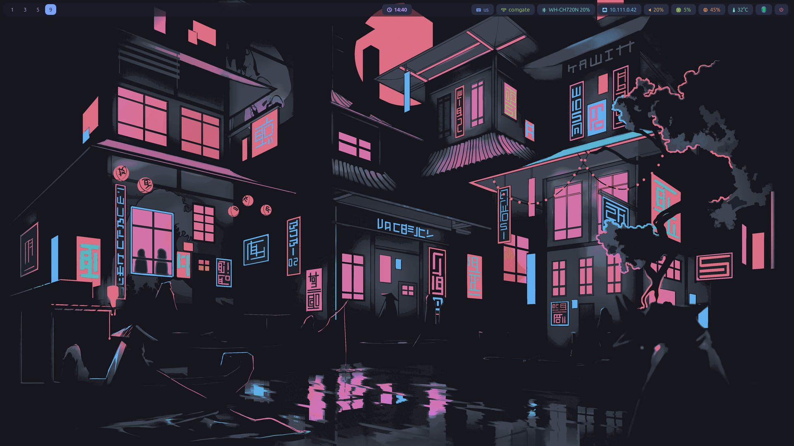
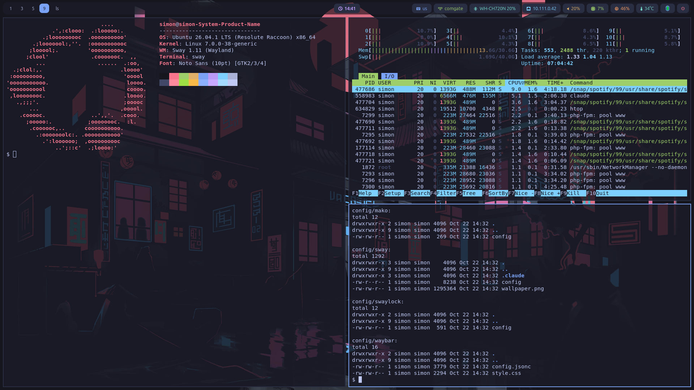
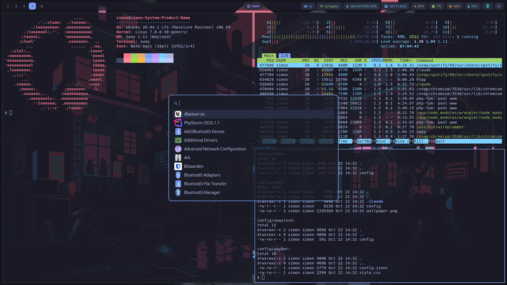

# sway Tokyo Night

Tokyo Night theme for sway on Ubuntu: waybar, mako, fuzzel, foot, gtklock.





## Install

```sh
git clone https://github.com/SimonZanta/sway-tokio-night.git
cd sway-tokio-night
./install.sh
```

The script installs the packages with apt and copies the configs into `~/.config`, overwriting existing ones.

## Keys

| Key | Action |
|---|---|
| `Super+l` | Lock screen (gtklock) |
| `Alt+Shift` | Switch keyboard layout (us / cz qwerty) |
| Media keys | Play/pause, next, previous (playerctl) |

## Credits

Wallpaper: [alchem1no/tokyonight-wallpapers](https://github.com/alchem1no/tokyonight-wallpapers) (Unlicense).
